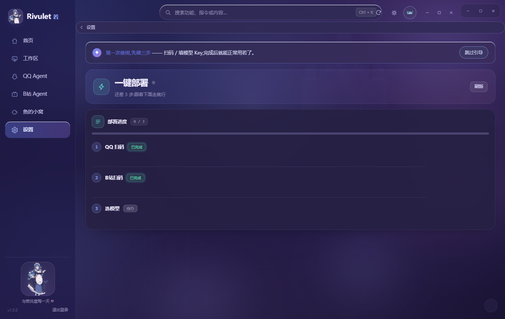
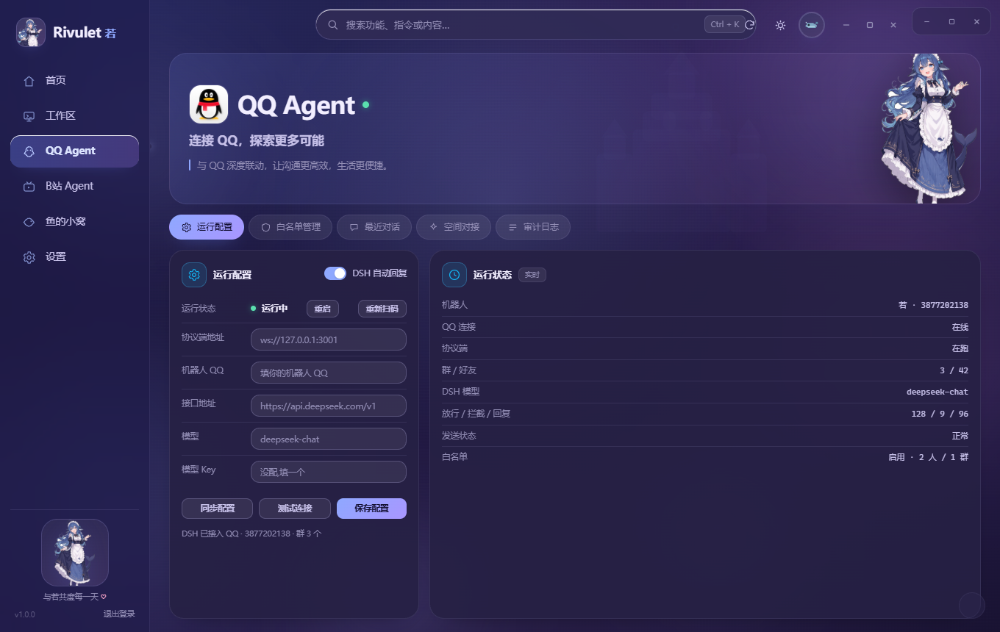

# Rivulet 若

> 一个住在你电脑里的小鲸鱼。陪你聊天、管 QQ、管 B站、记账、养鱼种菜。
> **一个 exe，双击就能用** —— 不用装 Python、不用装 Node、不用装任何环境。


---

## 一、下载与打开（3 步）

### 1. 下载
去 [Releases](../../releases) 下载 **`Rivulet若-v0.10.1-win64.exe`**（144 MB）。

### 2. 放到一个能写文件的位置
- ✅ 桌面、D 盘、E 盘
- ❌ 不要放 `C:\Program Files`（没有写权限，解压会失败）

### 3. 双击运行

第一次启动会**等 20~40 秒**，因为它在解压内置的运行环境（约 350 MB）。

> 看到界面没出来是正常的，别关。之后每次启动只要几秒。

如果弹出 **「Windows 已保护你的电脑」**：
点 **更多信息** → **仍要运行**。程序没有数字签名，这个提示是正常的。

---

## 二、注册账号

第一次打开是登录页，点 **注册** 建一个账号。

- 账号只存在**你这台电脑**上，不上传任何服务器
- 自助注册只能建普通用户（管理员只能本机登录，见文末）

---

## 三、第一次进来：照着「一键部署」走

新用户登录后会自动落在 **一键部署** 页，三步走完就能用。



### 第 1 步：B站（可以跳过）

点 **扫码登录** → 用手机 B站 扫一下 → 手机上点确认。

> 状态会自动刷新：出码 → 已扫码 → 已登录。如果二维码过期，重新生成一次。

### 第 2 步：QQ（可以跳过）

点 **启动协议端** → 等二维码出来 → 手机 QQ 扫一下。

扫完手机会确认登录。**登录成功后，程序会自动把你这个号设成主人并加入白名单**，你发消息它就会回。

> QQ 提示「账号存在安全风险」是 QQ 官方的风控，不是程序问题。
> 在手机 QQ 上完成验证，或换个网络（手机热点）再扫，或点 **重新扫码**。

### 第 3 步：配模型（必做）

这一步决定「若」能不能说话。选一个服务商，填 Key，点保存。



**最常见的三种情况：**

| 你用的服务 | 接口地址填什么 | 模型名填什么 |
|---|---|---|
| DeepSeek 官方 | `https://api.deepseek.com/v1` | `deepseek-chat` |
| **OpenCode Zen** | **后台给你的地址（要带 `/v1`）** | **后台列表里的模型名** |
| 中转站 / 公司网关 | 对方给你的地址（带 `/v1`） | 对方列表里的模型名 |

> ⚠️ **只填 Key 不填地址 = 一定会失败。**
> 程序默认往 `api.deepseek.com` 发，你拿别家的 Key 去调它，当然 401。
> 这就是「配了 Key 还是没反应」最常见的原因。

配完点 **测试连接**：
- ✅ 提示「连上了：模型名 回复「...」」→ 成功
- ❌ 提示「HTTP 401 Key 不对」「404 接口地址或模型名不对」→ 按提示改

在一键部署里配好的模型会**自动同步给 QQ**，不用再配第二遍。

---

## 四、各板块能干什么

| 板块 | 说明 |
|---|---|
| 工作区 | 沉浸式对话，用的是你在「一键部署」里配的模型 |
| QQ Agent | 自动回复、白名单、最近对话、发说说、主动消息、审计日志 |
| B站 Agent | 投稿、稿件管理、评论回复、每日推荐 |
| 记忆树 | 记忆检索、筛选、详情、模糊记忆 |
| 鱼的小窝 | 纯本地生活引擎：小家、田地、工坊、账本、日记（不联网） |
| 心情 / 设置 | 情绪状态、主题、账号 |

---

## 五、你的数据在哪

程序目录下这几个文件夹：

```
data\            首页状态、鱼窝存档
core\data\       账号库
services\data\   QQ 白名单、审计日志、人格
fatfish\data\    B站 登录 Cookie
```

- 搬家时**整个文件夹一起搬**
- 登录态和 Key 用当前 Windows 账号加密，**换电脑要重新登录、重新填 Key**
- 这些目录里有你的聊天和记忆，**不要发给别人**

---

## 六、升级到新版本

直接用新 exe **覆盖**旧的，双击运行。

程序会自动：
1. 检查版本和一个 8 项关键文件清单
2. **清空旧的程序文件**（`runtime\` `core\` `services\` `fatfish\`）
3. **保留你的数据**（每层里的 `data` 目录不动）
4. 重新解压 → 校验通过才算成功

> 升级前先把正在运行的 Rivulet 关掉，否则文件被占用删不掉。
> 出问题看程序目录下的 **`startup.log`**，里面写了卡在哪一步。

---

## 七、常见问题

**Q：双击没反应 / 一闪就没了**
看程序目录有没有 `startup.log`，把内容发出来。多半是放在了没有写权限的目录。

**Q：提示「连不上账号服务」**
等十几秒再试（首次在解压）；还不行看 `core\core.log`；或 8088 端口被别的程序占了。

**Q：QQ 扫码后一条消息都不回**
1. 先点 **测试连接**，确认模型通了
2. 确认你在**白名单**里（登录成功会自动加）
3. 看 QQ 页的「最近对话」有没有收到消息

**Q：B站 扫码后没变成「已登录」**
点重新生成再来一次；出码后请在 **60 秒内**扫码确认。

**Q：窗口关不掉**
右上角有三个按钮（最小化 / 最大化 / 关闭），关闭按钮悬停会变红。

**Q：管理员账号**
自助注册建不出管理员。管理员账号**只能在本机登录**，从外部网络访问即使密码对了也会被拒绝。

---

## 八、许可

- 本项目开源、**不用于任何商业目的**
- 创作者：泥泥；核心贡献者：啵啵小C
- 鲸鱼娘形象按 **CC BY-NC-SA 4.0** 提供，不得商用
- 内置的 QQ 协议端（NapCat）遵循其自身许可

第三方组件清单见 [THIRD-PARTY-NOTICES.txt](THIRD-PARTY-NOTICES.txt)。
