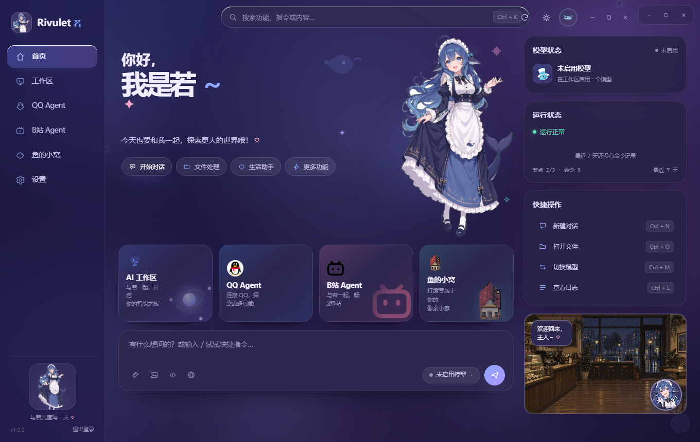

# Rivulet 若

若是 Windows 桌面 AI 伙伴。可以在工作区聊天，按需连接 QQ 和 B 站，也可以单独玩鱼的小窝。

## 下载和第一次打开

1. 打开 [GitHub 发布页](../../releases)。要使用下文的「快速开始」，请选择 **配置引导预览版**，在 **Assets（附件）** 里下载 Windows 64 位的 **单文件 .exe**。原正式版也可在发布页下载。
2. 建一个自己能写入的文件夹，比如桌面上的「Rivulet 若」，把 exe 放进去。程序第一次运行会在旁边准备运行环境，可能需要几十秒。
3. 双击打开。第一次使用，在登录页点 **注册**，创建本机账号后再登录。
4. 在 **快速开始** 里，想聊天就点 **配置聊天模型**。QQ 和 B 站都可以以后再连。点 **先去首页** 可以直接使用小窝等本地功能。

下面的按钮名称对应带「快速开始」的配置引导版。旧版显示「一键部署」，界面和步骤会有差异。

## 工作区：第一次和若聊天

1. 打开 **工作区**，点对话区里的 **配置聊天模型**。
2. 选择你在哪个平台开通了模型 API，例如 **DeepSeek 官方**。点 **打开获取密钥页面** 前往服务商页面，创建并复制 **API 密钥（API Key）**。
3. 把密钥粘贴回若，点 **测试并启用**。测试通过后点 **开始对话**，发一句「你好」。

| 你的情况 | 怎么填 |
| --- | --- |
| DeepSeek 官方、阿里云百炼或 OpenAI 官方 | 选对应的服务商。接口地址和模型名会预填，通常只需粘贴密钥。百炼的默认地址对应中国内地，其他地域用控制台提供的地址。 |
| 中转站、公司网关或其他平台 | 选 **其他兼容服务 / 中转 / LM Studio**，在 **接口地址和模型名** 中填平台提供的 OpenAI 兼容地址和模型标识，再粘贴同一家平台的密钥。 |
| 本机 Ollama | 先启动 Ollama，再选 **Ollama（本机）**，填你已下载的模型名。本机服务没有设置密钥时可留空。 |

API 密钥是服务商给你的调用凭证。网页登录密码、聊天产品会员和若的本机账号都不能当作 API 密钥。模型 API 的余额和用量在服务商控制台查看。

想更换配置时，到工作区右栏点 **管理聊天模型**。同一接口地址已保存密钥时可以留空沿用。测试失败时，之前启用的模型会继续保留。

## QQ：让若在 QQ 里自动回复

1. 打开 **QQ Agent → 运行配置**，点 **扫码登录 QQ**。用你要当作机器人使用的 QQ 账号扫右侧二维码，在手机上确认，等界面显示已登录。
2. 点 **使用工作区模型**。工作区已启用模型时直接使用；还没配置时会打开同一个配置窗口。要为 QQ 使用独立账户或模型，点 **给 QQ 单独配置**。
3. 确认 **自动回复** 开着。点 **管理白名单**，添加用来发送消息的另一个 QQ 号，再用那个号私聊机器人发一句「你好」。
4. 如果没有回复，点 **测试回复模型**，再到 **最近对话** 看有没有收到消息。群聊默认只会回复白名单群里提到机器人的消息。

二维码失效时点 **重新生成二维码**。如果 QQ 要求安全验证，请在手机 QQ 里按官方提示处理后再试。

## B 站：扫码登录、看稿件和回评论

1. 打开 **B站 Agent**，点顶部 **扫码登录 B 站**。
2. 用手机哔哩哔哩 App 扫码，再在手机上点确认。电脑上显示 **已登录** 后点 **完成**。
3. 在 **我的稿件** 和 **评论区** 查看内容。要从若提交视频、修改稿件或回复评论，先在 **账号** 里打开 **允许投稿和回复**。
4. 需要 AI 生成评论时，在 **账号 → AI 生成评论** 配置工作区的聊天模型，再到 **刷推荐** 选择是否使用评论功能。扫码、看稿和手动回复都可以独立使用。

登录过期时点 **扫码登录 B 站**，二维码过期时选 **重新生成二维码**。

## 其他功能

| 入口 | 用途 |
| --- | --- |
| 鱼的小窝 | 在本机使用小家、田地、工坊、账本和日记。 |
| 设置 → 快速开始 | 随时查看聊天模型、QQ 和 B 站的准备状态。 |
| 设置 → 人格 / 心情 / 记忆树 | 调整说话风格、查看心情状态与可用的记忆记录。 |

## 备份和升级

1. 先退出若，再把原程序所在的**整个文件夹**备份到另一个位置。
2. 把新版 exe 放到原文件夹后运行。这样程序才能找到已经保存的本机数据。如果平台要求重新登录，按前面的扫码步骤再连一次。
3. 用户数据主要在程序旁边以及 `core`、`services`、`fatfish` 下的 `data` 文件夹。账号、聊天、API 密钥和平台登录凭证都不适合公开分享。分享若时请发下载页链接。

若将本机账户和本机保存的数据留在电脑上。使用云模型、QQ 或 B 站功能时，请求会发往所选服务商或平台。仅保存在本机的数据也建议定期备份。

## 常见问题

| 看到什么 | 可以怎么做 |
| --- | --- |
| 双击后窗口迟迟没出来 | 第一次请稍等。确认 exe 放在自己有写入权限的文件夹，随后重开。如果重复失败，保留程序目录里的 `startup.log`，分享前检查其中是否包含个人目录。 |
| 本机账号服务暂时连不上 | 首次运行准备完成后再试。仍有问题时先退出其他已打开的若，再启动要用的那一版。 |
| 测试说密钥无效、没权限或额度不足 | 回到所选服务商的控制台，检查 API 密钥、可用模型和账户额度。 |
| 测试说找不到接口或模型 | 展开 **接口地址和模型名**，按同一个服务商的控制台逐项核对。 |
| QQ 已扫码但没回复 | 确认 QQ 连接、回复模型、自动回复和发送账号的白名单都已就绪。 |
| B 站已扫码但仍显示待确认 | 检查手机上是否点了确认登录。电脑提示超时或过期时重新生成二维码。 |

## 许可与署名

创作者：泥泥。核心贡献者：啵啵小C。项目许可见 [LICENSE](LICENSE)，界面素材署名见 [素材说明](ui/assets/CREDITS.md)。NapCat 按其自身许可使用。
